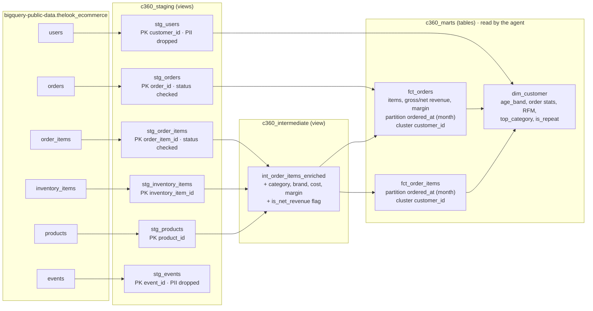

# Model lineage

Three layers. Staging views clean and rename and drop PII. The intermediate view holds the joins and the
net-revenue rule. Mart tables are the only objects the agent may query.

## Rules carried in the models

- Net revenue counts items with status Complete, Shipped or Processing. Cancelled and Returned are excluded.
- RFM scores are NTILE(5) over customers with at least one order; 5 is best on every axis.
- Customers who never ordered stay in `dim_customer` with zero orders, null RFM scores and segment Other.

## Tests

- `unique` and `not_null` on every staging key and every mart key.
- `accepted_values` on `status` in staging orders and order items.
- `relationships` from `fct_orders.customer_id` and `fct_order_items.customer_id` to `dim_customer`.
- Singular: RFM scores between 1 and 5 for every customer with an order.
- Singular: total net revenue in `fct_orders` equals `fct_order_items` within 0.01.
- Source freshness on `orders.created_at` warns after 36 hours.
