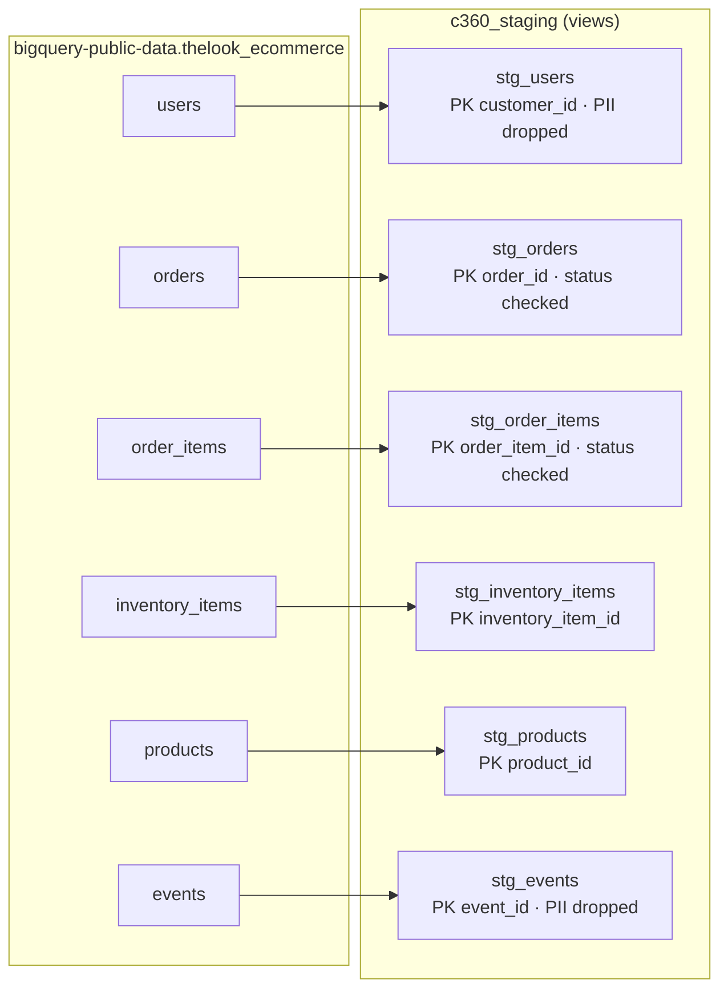

# Model lineage

Phase 1: raw source tables to staging views. Staging renames and casts columns and drops PII. No joins, no business logic.

Every staging key has `unique` and `not_null` tests. `status` in orders and order items must be one of
Cancelled, Complete, Processing, Returned, Shipped. Source freshness on `orders.created_at` warns after 36 hours.
