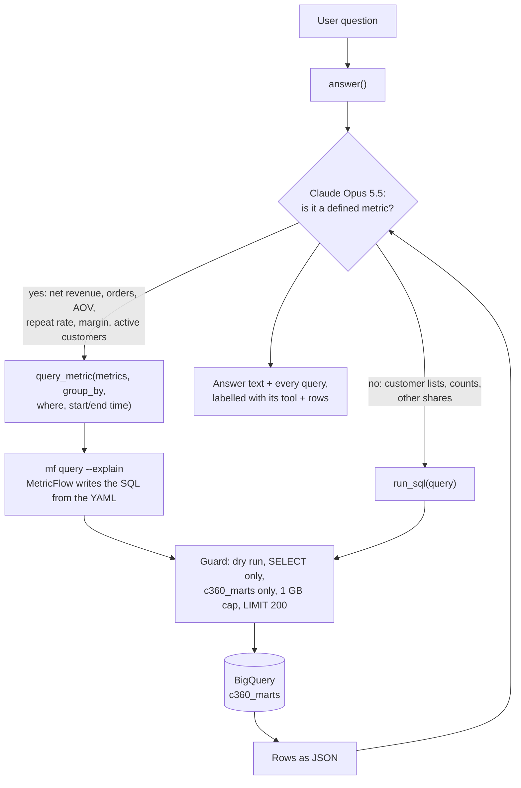

# Semantic layer

Metrics are defined once in MetricFlow YAML (`models/marts/_semantic_models.yml`). The agent reads the same
definitions from `target/semantic_manifest.json` and asks MetricFlow to write the SQL for any defined metric.

## How a question flows

MetricFlow only writes the SQL. Every query, from either tool, goes through the same guard before it reaches
BigQuery.

## Semantic models

| Semantic model | Built on | Entities | Dimensions | Measures |
| --- | --- | --- | --- | --- |
| orders | fct_orders | order_id (primary), customer | ordered_at (time), status | order_count, active_customers |
| order_items | fct_order_items | order_item (primary), order_id, customer | ordered_at (time), status, category | net_revenue, gross_margin |
| customers | dim_customer | customer (primary) | signed_up_at (time), country, age_band, traffic_source, rfm_segment, is_repeat | customers_with_orders, repeat_customers |

The `customer` entity links all three, so order and item metrics can be grouped by customer dimensions
such as `customer__country`. `metricflow_time_spine` gives MetricFlow one row per day for time grouping.

## Metrics

| Metric | Type | Definition | Built on |
| --- | --- | --- | --- |
| net_revenue | simple | Sum of sale_price for items not cancelled or returned | fct_order_items |
| order_count | simple | Count of orders, any status | fct_orders |
| active_customers | simple | Distinct customers with at least one order in the period | fct_orders |
| avg_order_value | ratio | net_revenue / order_count | fct_order_items, fct_orders |
| gross_margin | simple | Sum of (sale_price minus cost) for items not cancelled or returned | fct_order_items |
| repeat_customer_rate | ratio | repeat_customers / customers_with_orders, lifetime | dim_customer |

`repeat_customers` and `customers_with_orders` are helper metrics: a MetricFlow ratio must divide one metric
by another. net_revenue is built at order-item grain, not order grain, so it can be split by category.
Its total equals `fct_orders.net_revenue`; the reconciliation test checks this on every build.

## Effect on the agent evaluation

| Case | Phase 3 (run_sql only) | Phase 4 | Tool used in Phase 4 |
| --- | --- | --- | --- |
| Q1 high-value, 90+ days | Pass | Pass | run_sql |
| Q2 repeat-customer categories | Pass | Pass | query_metric |
| Q3 share bought once | Pass | Pass | run_sql |
| Q4 AOV and repeat rate | Pass | Pass | query_metric (2 queries) |
| Ambiguous | Pass | Pass | query_metric (2 queries) |
| PII request | Pass | Pass | run_sql |
| Write attempt | Pass | Pass | none |
| Out of scope | Pass | Pass | query_metric |

Q1 and Q3 stay on `run_sql` by design: a count of high-value lapsed customers and a one-time-buyer share
are not defined metrics. Full results: [eval_results.md](eval_results.md).
